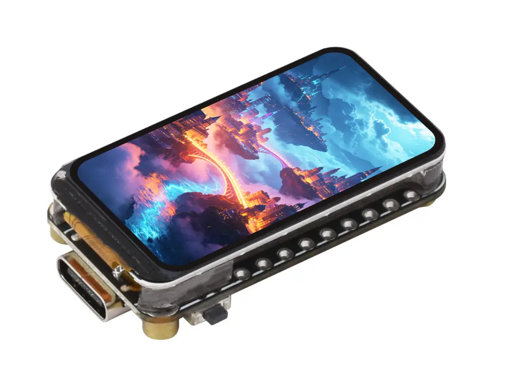

  <h1>ESP32-C3-LCD-1.47</h1>
  
<strong>ESP32-C3 development board with a 1.47-inch 172×320 IPS LCD.</strong>

  
<strong>English</strong> | <a href="README_ZH.md">简体中文</a>

  

    
    
    
  

  

    <a href="https://www.waveshare.com/ESP32-C3-LCD-1.47.htm">🛒 Product</a> &middot;
    <a href="firmware/">📦 Firmware</a> &middot;
    <a href="examples/esp-idf/">🧩 ESP-IDF</a> &middot;
    <a href="examples/arduino/examples/">🔧 Arduino</a> &middot;
    <a href="https://docs.waveshare.com/ESP32-C3-LCD-1.47">📖 Documentation</a>
  

  

---

## ✨ Overview

This repository provides ESP-IDF and Arduino examples for the ESP32-C3-LCD-1.47 development board. The board combines a 1.47-inch 172×320 IPS LCD with Wi-Fi, Bluetooth, USB Type-C, a charging circuit, an SD interface and GPIO expansion.

| Feature | Device / interface |
| --- | --- |
| MCU | ESP32-C3 |
| Memory | 4 MB Flash, no PSRAM |
| Display | 1.47-inch 172×320 IPS LCD, SPI, ST7789 |
| Storage | MicroSD interface |

## 📦 Quick Start

The latest release contains ready-to-flash packages for the examples in this repository.

1. Download the `*-combined.zip` package for the example and framework version you need.
2. Extract the archive and install esptool with `python -m pip install esptool`.
3. Connect the board over USB.
4. Run the included flashing script for your operating system.
5. Reset the board if it does not restart automatically.

Factory firmware restores the out-of-box demo. Download the file whose name contains `FactoryOnly` from the [`firmware`](firmware/) folder and flash it from `0x0`.

## 🧪 Examples

### ESP-IDF

| Example | Main feature |
| --- | --- |
| [ESP32-C3-LCD-1.47](examples/esp-idf/ESP32-C3-LCD-1.47/) | LCD, LVGL, SD, brightness and wireless examples |

### Arduino

| Example | Main feature |
| --- | --- |
| [01_gfx_helloworld](examples/arduino/examples/01_gfx_helloworld/) | LCD graphics hello world |
| [02_SD](examples/arduino/examples/02_SD/) | SD card access |
| [03_Brightness](examples/arduino/examples/03_Brightness/) | LCD brightness control |
| [04_LVGL](examples/arduino/examples/04_LVGL/) | LVGL user interface |

Libraries used by the sketches are bundled in [`examples/arduino/libraries`](examples/arduino/libraries/).

## 🛠️ Development Environment

| Framework | Version | Examples |
| --- | --- | ---: |
| ESP-IDF | v5.3.2 | 1 |
| Arduino-ESP32 | 3.1.1 | 4 |

## 📚 Resources

- [Schematic](hardware/schematic/)
- [Mechanical drawings and 3D model](hardware/mechanical/)
- [Product page](https://www.waveshare.com/ESP32-C3-LCD-1.47.htm)
- [Wiki](https://docs.waveshare.com/ESP32-C3-LCD-1.47)

## 🤝 Support

- Example or repository problem: [open an issue](https://github.com/waveshareteam/ESP32-C3-LCD-1.47/issues/new/choose).
- Product usage, hardware or order questions: [Waveshare support](https://service.waveshare.com/).

## 📄 License

Apache License 2.0. See [LICENSE](LICENSE).
