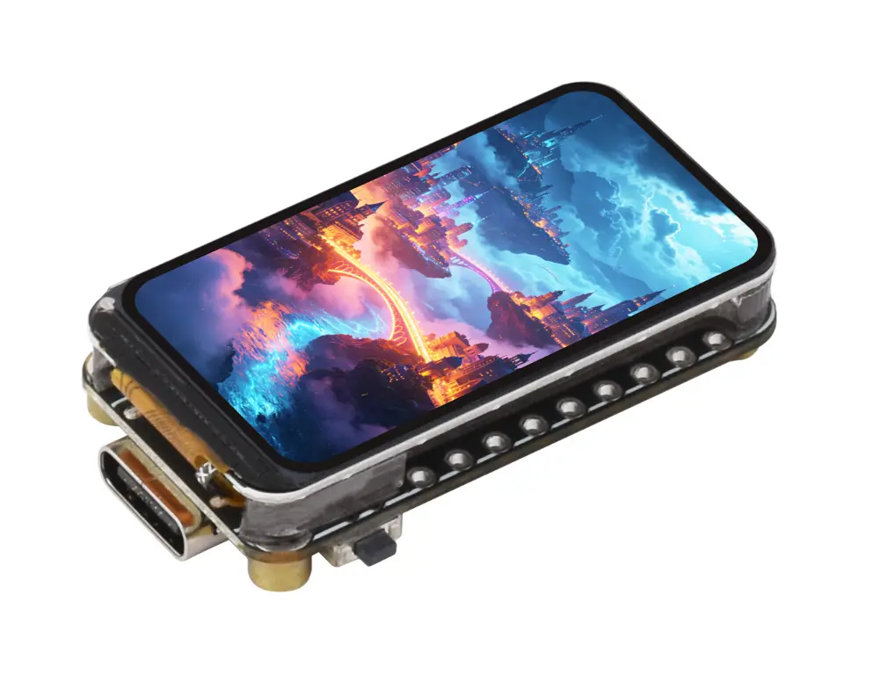

# Waveshare ESP32-C3-LCD-1.47 产品工程示例程序

[English](README.md)

这款产品是由 Waveshare 推出的基于 ESP32-C3 的小型显示开发板，集成了一块 1.47 英寸 SPI 接口 IPS 彩色液晶屏，分辨率为 172×320，显示效果细腻，适合用于轻量级图形界面展示。

-  [购买链接](https://www.waveshare.net/shop/ESP32-C3-LCD-1.47.htm)
-  [产品文档](https://docs.waveshare.net/ESP32-C3-LCD-1.47/)

---

## 🔧 配置

您可以在产品 Wiki 页面上找到详细的配置信息。

---

## 🛠️ 贡献

我们欢迎您的贡献！您可以通过以下方式提供帮助：

1. Fork 本仓库。
2. 为您的新功能或 Bug 修复创建一个新分支。
3. 提交您的更改并附上清晰的描述。
4. 提交 Pull Request 以供审核。

---

## 🧩 问题与支持

如果您遇到任何问题：

- 请先查看 [Issues](https://gitee.com/waveshare/ESP32-C3-LCD-1.47/issues) 版块。
- 创建一个新的 Issue 并提供详细信息。
- 参考文档获取故障排除提示。
- 联系微雪团队并提供订单号以获取技术支持。

---

## 📜 许可

本仓库遵循 Apache License 许可。详情请参阅 [LICENSE](LICENSE) 文件。

---

## 🙌 致谢

- 感谢微雪电子提供的优秀硬件平台和软件支持。
- 感谢乐鑫团队的持续支持。
- 感谢让这些项目成为可能的开源贡献者。

---

感谢您使用微雪电子产品！🚀
