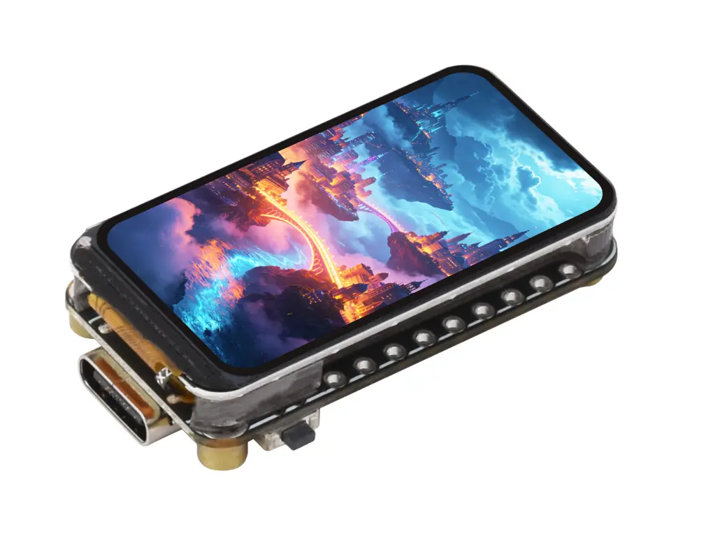

# 微雪 ESP32-C3-LCD-1.47

[English](README.md)

[🛒 产品](https://www.waveshare.net/shop/ESP32-C3-LCD-1.47.htm) · [📦 固件](firmware/) · [🧩 ESP-IDF](examples/esp-idf/ESP32-C3-LCD-1.47/) · [🔧 Arduino](examples/arduino/examples/) · [📖 文档](https://docs.waveshare.net/ESP32-C3-LCD-1.47/)

## ✨ 概述

ESP32-C3 显示开发板，配备 1.47 英寸 172×320 IPS 液晶屏、Wi-Fi、蓝牙、USB Type-C、充电电路、SD 接口和 GPIO 扩展。板载 4 MB Flash，无 PSRAM。

## 📦 快速开始

下载[出厂固件](firmware/ESP32-C3-LCD-1.47_FactoryOnly_20260514.bin)，按合并固件方式烧录。

## 🧪 示例

| 框架 | 示例 |
| --- | --- |
| ESP-IDF | [工程](examples/esp-idf/ESP32-C3-LCD-1.47/) |
| Arduino | [图形](examples/arduino/examples/01_gfx_helloworld/)、[SD](examples/arduino/examples/02_SD/)、[亮度](examples/arduino/examples/03_Brightness/)、[LVGL](examples/arduino/examples/04_LVGL/) |

## 🛠️ 开发环境

| 框架 | 版本 | 示例数 |
| --- | --- | --- |
| ESP-IDF | v5.3.2 | 1 个工程 |
| Arduino core | 3.1.1 | 4 个 |

## 📚 资料

- [原理图](hardware/schematic/ESP32-C3-LCD-1.47-Schematic.pdf)
- [机械图](hardware/mechanical/ESP32-C3-LCD-1.47-Mechanical.dxf)
- [3D 模型](hardware/mechanical/ESP32-C3-LCD-1.47-3D.step)
- [产品页](https://www.waveshare.net/shop/ESP32-C3-LCD-1.47.htm)
- [Wiki](https://docs.waveshare.net/ESP32-C3-LCD-1.47/)

## 🤝 支持

请在 [Gitee Issues](https://gitee.com/waveshare/ESP32-C3-LCD-1.47/issues) 提交问题，或查看[技术支持](https://docs.waveshare.net/ESP32-C3-LCD-1.47/Technical-Support/)。

## 📄 许可证

本仓库使用 Apache License 2.0，详见 [LICENSE](LICENSE)。
